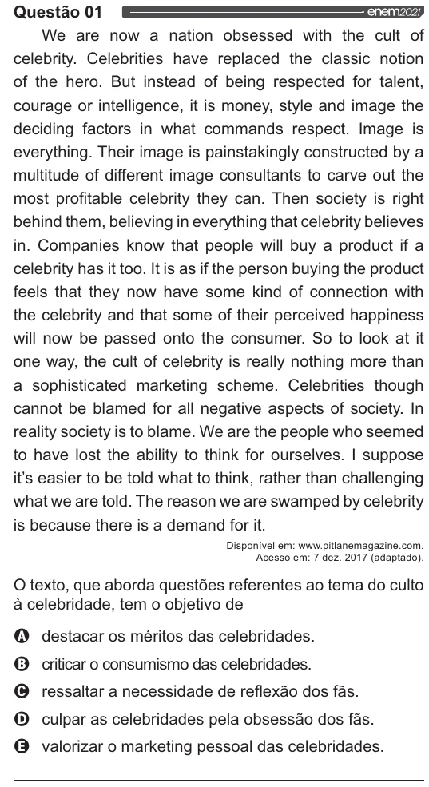

Texto extraído (pode conter ruído)

Questão 01  
enemoo2,,  
We are now a nation obsessed with the cult of  
celebrity. Celebrities have replaced the classic notion  
of the hero. But instead of being respected for talent,  
courage or intelligence, it is money, style and image the  
deciding factors in what commands respect. Image is  
everything. Their image is painstakingly constructed by a  
multitude of different image consultants to carve out the  
most profitable celebrity they can. Then society is right  
behind them, believing in everything that celebrity believes  
in. Companies know that people will buy a product if a  
celebrity has it too. Itis as ifthe person buying the product  
feels that they now have some kind of connection with  
the celebrity and that some of their perceived happiness  
will now be passed onto the consumer. So to look at it  
one way, the cult of celebrity is really nothing more than  
a sophisticated marketing scheme. Celebrities though  
cannot be blamed for all negative aspects of society. In  
reality society is to blame. We are the people who seemed  
to have lost the ability to think for ourselves. | suppose  
it's easier to be told what to think, rather than challenging  
what we are told. The reason we are swamped by celebrity  
is because there is a demand for it.  
Disponível em: www pitlanemagazine.com.  
Acesso em: 7 dez. 2017 (adaptado).  
O texto, que aborda questões referentes ao tema do culto  
à celebridade, tem o objetivo de  
VOO  
destacar os méritos das celebridades.  
criticar o consumismo das celebridades.  
ressaltar a necessidade de reflexão dos fãs.  
culpar as celebridades pela obsessão dos fãs.  
valorizar o marketing pessoal das celebridades.

