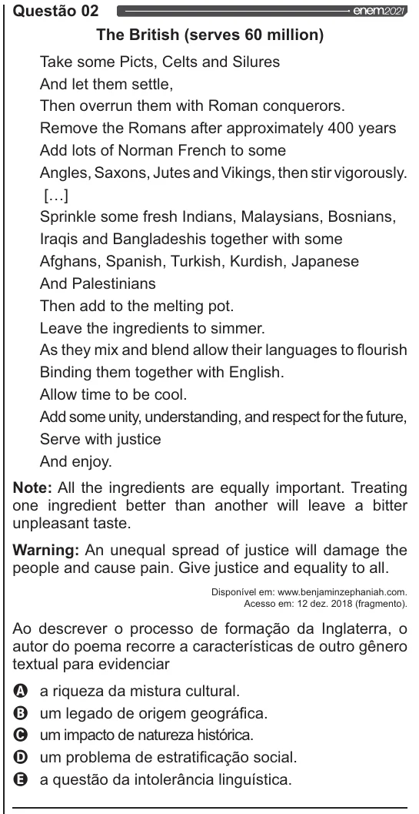

Texto extraído (pode conter ruído)

Questão 02  
The British (serves 60 million)  
Take some Picts, Celts and Silures  
And let them settle,  
Then overrun them with Roman conquerors.  
Remove the Romans after approximately 400 years  
Add lots of Norman French to some  
Angles, Saxons, Jutes and Vikings, then stir vigorously.  
[...]  
Sprinkle some fresh Indians, Malaysians, Bosnians,  
lragis and Bangladeshis together with some  
Afghans, Spanish, Turkish, Kurdish, Japanese  
And Palestinians  
Then add to the melting pot.  
Leave the ingredients to simmer.  
As they mix and blend allow their languages to flourish  
Binding them together with English.  
Allow time to be cool.  
Add some unity, understanding, and respect for the future,  
Serve with justice  
And enjoy.  
Note: All the ingredients are equally important. Treating  
one ingredient better than another will leave a bitter  
unpleasant taste.  
Warning: An unequal spread of justice will damage the  
people and cause pain. Give justice and equality to all.  
Disponível em: www.benjaminzephaniah.com.  
Acesso em: 12 dez. 2018 (fragmento).  
Ao descrever o processo de formação da Inglaterra, o  
autor do poema recorre a características de outro gênero  
textual para evidenciar  
VOO  
a riqueza da mistura cultural.  
um legado de origem geográfica.  
um impacto de natureza histórica.  
um problema de estratificação social.  
a questão da intolerância linguística.

