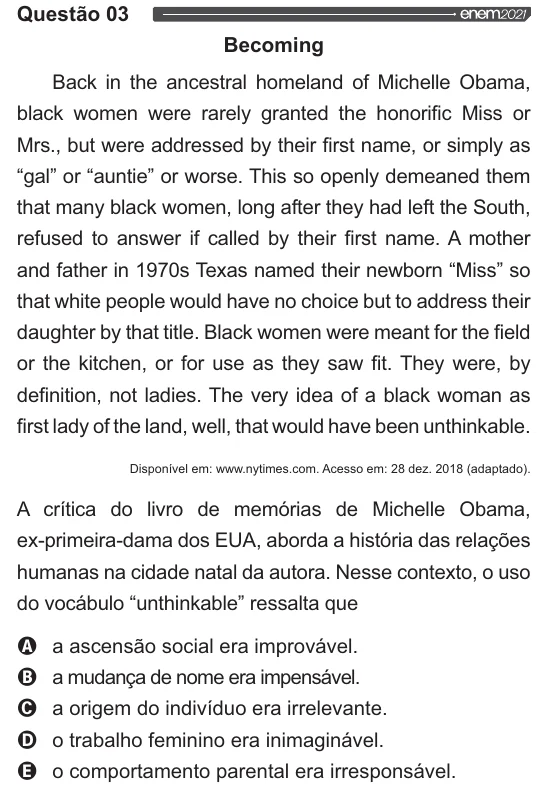

Texto extraído (pode conter ruído)

Questão 03 Enem202  
Becoming  
Back in the ancestral homeland of Michelle Obama,  
black women were rarely granted the honorific Miss or  
Mrs., but were addressed by their first name, or simply as  
“gal” or “auntie” or worse. This so openly demeaned them  
that many black women, long after they had left the South,  
refused to answer if called by their first name. A mother  
and father in 1970s Texas named their newborn “Miss” so  
that white people would have no choice but to address their  
daughter by that title. Black women were meant for the field  
or the kitchen, or for use as they saw fit. They were, by  
definition, not ladies. The very idea of a black woman as  
first lady of the land, well, that would have been unthinkable.  
Disponível em: www.nytimes.com. Acesso em: 28 dez. 2018 (adaptado).  
A crítica do livro de memórias de Michelle Obama,  
ex-primeira-dama dos EUA, aborda a história das relações  
humanas na cidade natal da autora. Nesse contexto, o uso  
do vocábulo “unthinkable” ressalta que  
VOO  
a ascensão social era improvável.  
a mudança de nome era impensável.  
a origem do indivíduo era irrelevante.  
o trabalho feminino era inimaginável.  
o comportamento parental era irresponsável.

