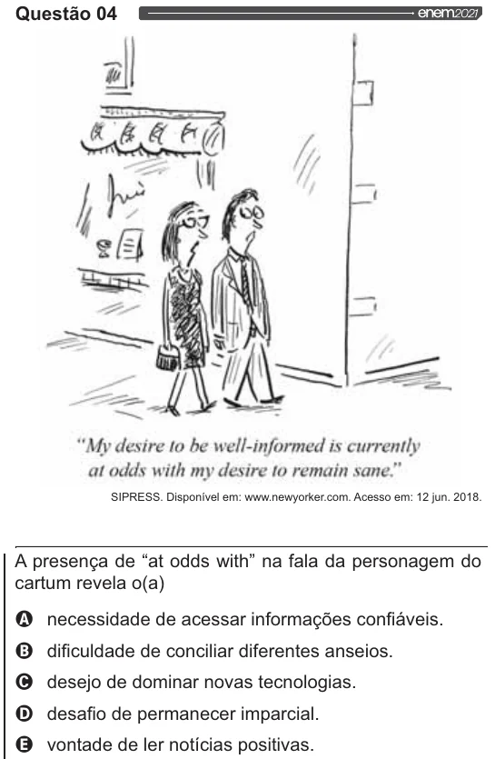

Texto extraído (pode conter ruído)

Questão 04  
enemoozi,  
“My desire to be well-informed is currently  
at odds with my desire to remain sane”  
SIPRESS. Disponível em: www.newyorker.com. Acesso em: 12 jun. 2018.  
A presença de “at odds with” na fala da personagem do  
cartum revela o(a)  
Q necessidade de acessar informações confiáveis.  
O dificuldade de conciliar diferentes anseios.  
O desejo de dominar novas tecnologias.  
O desafio de permanecer imparcial.  
Q& vontade de ler notícias positivas.

