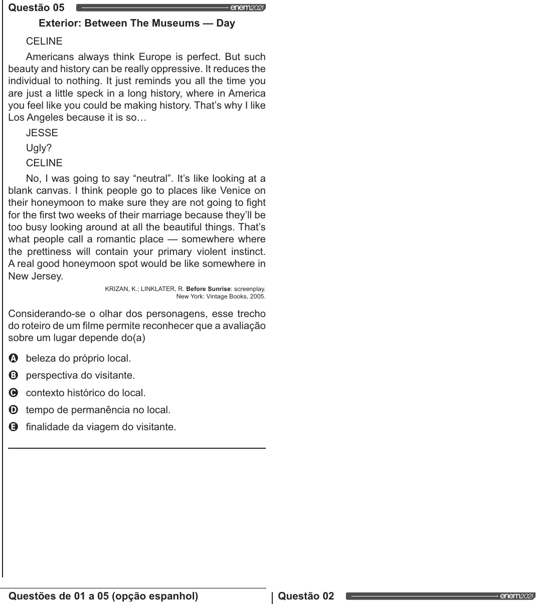

Texto extraído (pode conter ruído)

Questão 05  
Exterior: Between The Museums — Day  
CELINE  
Americans always think Europe is perfect. But such  
beauty and history can be really oppressive. It reduces the  
individual to nothing. It just reminds you all the time you  
are just a little speck in a long history, where in America  
you feel like you could be making history. That's why | like  
Los Angeles because it is so...  
JESSE  
Ugly?  
CELINE  
No, | was going to say “neutral”. It's like looking at a  
blank canvas. | think people go to places like Venice on  
their honeymoon to make sure they are not going to fight  
for the first two weeks of their marriage because they'll be  
too busy looking around at all the beautiful things. That's  
what people call a romantic place — somewhere where  
the prettiness will contain your primary violent instinct.  
A real good honeymoon spot would be like somewhere in  
New Jersey.  
KRIZAN, K.; LINKLATER, R. Before Sunrise: screenplay.  
New York: Vintage Books, 2005.  
Considerando-se o olhar dos personagens, esse trecho  
do roteiro de um filme permite reconhecer que a avaliação  
sobre um lugar depende do(a)  
VOOS  
beleza do próprio local.  
perspectiva do visitante.  
contexto histórico do local.  
tempo de permanência no local.  
finalidade da viagem do visitante.  
Questões de 01 a 05 (opção espanhol)  
Questão 02

