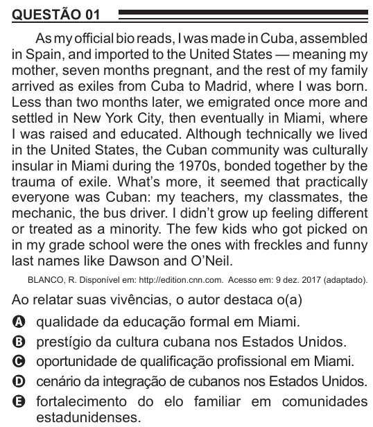

Texto extraído (pode conter ruído)

QUESTÃO 01  
As my official bio reads, I was made in Cuba, assembled  
in Spain, and imported to the United States — meaning my  
mother, seven months pregnant, and the rest of my family  
arrived as exiles from Cuba to Madrid, where I was born.  
Less than two months later, we emigrated once more and  
settled in New York City, then eventually in Miami, where  
I was raised and educated. Although technically we lived  
in the United States, the Cuban community was culturally  
insular in Miami during the 1970s, bonded together by the  
trauma of exile. What’s more, it seemed that practically  
everyone was Cuban: my teachers, my classmates, the  
mechanic, the bus driver. I didn’t grow up feeling different  
or treated as a minority. The few kids who got picked on  
in my grade school were the ones with freckles and funny  
last names like Dawson and O’Neil.  
BLANCO, R. Disponível em: http://edition.cnn.com. Acesso em: 9 dez. 2017 (adaptado).  
Ao relatar suas vivências, o autor destaca o(a)  
qualidade da educação formal em Miami.  
A  
prestígio da cultura cubana nos Estados Unidos.  
B  
oportunidade de qualificação profissional em Miami.  
C  
cenário da integração de cubanos nos Estados Unidos.  
D  
fortalecimento do elo familiar em comunidades  
E  
estadunidenses.

