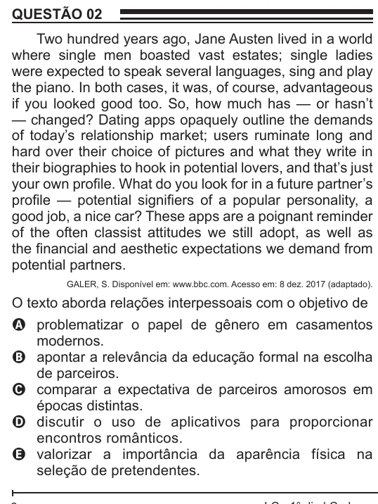

Texto extraído (pode conter ruído)

QUESTÃO 02  
Two hundred years ago, Jane Austen lived in a world  
where single men boasted vast estates; single ladies  
were expected to speak several languages, sing and play  
the piano. In both cases, it was, of course, advantageous  
if you looked good too. So, how much has — or hasn’t  
— changed? Dating apps opaquely outline the demands  
of today’s relationship market; users ruminate long and  
hard over their choice of pictures and what they write in  
their biographies to hook in potential lovers, and that’s just  
your own profile. What do you look for in a future partner’s  
profile — potential signifiers of a popular personality, a  
good job, a nice car? These apps are a poignant reminder  
of the often classist attitudes we still adopt, as well as  
the financial and aesthetic expectations we demand from  
potential partners.  
GALER, S. Disponível em: www.bbc.com. Acesso em: 8 dez. 2017 (adaptado).  
O texto aborda relações interpessoais com o objetivo de  
A problematizar o papel de gênero em casamentos  
modernos.  
B apontar a relevância da educação formal na escolha  
de parceiros.  
C comparar a expectativa de parceiros amorosos em  
épocas distintas.  
D discutir o uso de aplicativos para proporcionar  
encontros românticos.  
E valorizar a importância da aparência física na  
seleção de pretendentes.

