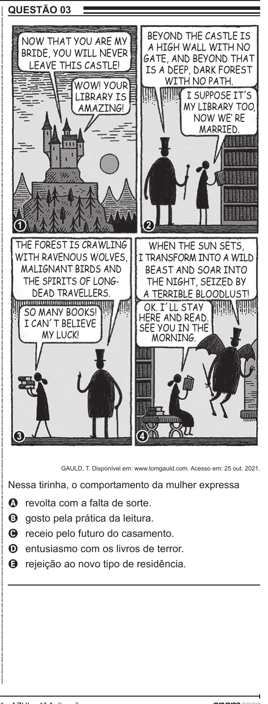

Texto extraído (pode conter ruído)

QUESTÃO 03  
ENEM 2022 ENEM 2022 ENEM 2022 ENEM 2022 ENEM 2022 ENEM 2022 ENEM 2022 ENEM 2022 ENEM 2022 ENEM 2022 ENEM 2022 ENEM 2022 ENEM 2022 ENEM 2022 ENEM 2022 ENEM 2022 ENEM 2022 ENEM 2022 ENEM 2022 ENEM 2022 ENEM 2022 ENEM 2022 ENEM 2022 ENEM 2022 ENEM 2022 ENEM 2022 ENEM 2022 ENEM 2022 ENEM 2022 ENEM 2022 ENEM 2022 ENEM 2022 ENEM 2022 ENEM 2022 ENEM 2022 ENEM 2022 ENEM 2022 ENEM 2022 ENEM 2022 ENEM 2022 ENEM 2022 ENEM 2022 ENEM 2022 ENEM 2022 ENEM 2022 ENEM 2022 ENEM 2022 ENEM 2022 ENEM 2022 ENEM 2022 ENEM 2022 ENEM 2022 ENEM 2022 ENEM 2022 ENEM 2022 ENEM 2022 ENEM 2022 ENEM 2022 ENEM 2022 ENEM 2022 ENEM 2022 ENEM 2022 ENEM 2022  
BEYOND THE CASTLE IS  
NOW THAT YOU ARE MY  
A HIGH WALL WITH NO  
BRIDE, YOU WILL NEVER  
GATE, AND BEYOND THAT  
LEAVE THIS CASTLE!  
IS A DEEP, DARK FOREST  
WITH NO PATH.  
WOW! YOUR  
I SUPPOSE IT´S  
LIBRARY IS  
MY LIBRARY TOO,  
AMAZING!  
NOW WE‛ RE  
MARRIED.  
1  
2  
THE FOREST IS CRAWLING  
WHEN THE SUN SETS,  
WITH RAVENOUS WOLVES,  
I TRANSFORM INTO A WILD  
MALIGNANT BIRDS AND  
BEAST AND SOAR INTO  
THE SPIRITS OF LONG-  
THE NIGHT, SEIZED BY  
DEAD TRAVELLERS.  
A TERRIBLE BLOODLUST!  
OK. I´LL STAY  
SO MANY BOOKS!  
HERE AND READ.  
I CAN´T BELIEVE  
SEE YOU IN THE  
MY LUCK!  
MORNING.  
3  
4  
GAULD, T. Disponível em: www.tomgauld.com. Acesso em: 25 out. 2021.  
Nessa tirinha, o comportamento da mulher expressa  
revolta com a falta de sorte.  
A  
gosto pela prática da leitura.  
B  
receio pelo futuro do casamento.  
C  
entusiasmo com os livros de terror.  
D  
rejeição ao novo tipo de residência.  
E

