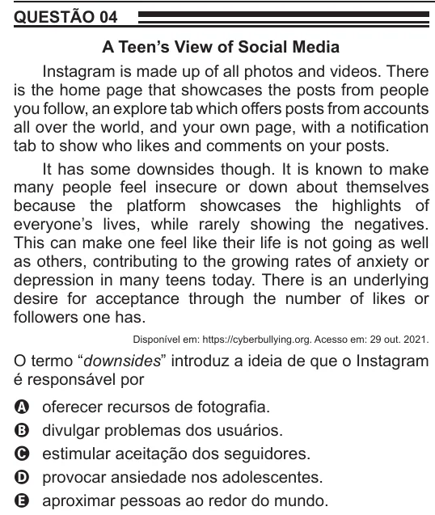

Texto extraído (pode conter ruído)

QUESTÃO 04  
A Teen’s View of Social Media  
Instagram is made up of all photos and videos. There  
is the home page that showcases the posts from people  
you follow, an explore tab which offers posts from accounts  
all over the world, and your own page, with a notification  
tab to show who likes and comments on your posts.  
It has some downsides though. It is known to make  
many people feel insecure or down about themselves  
because the platform showcases the highlights of  
everyone’s lives, while rarely showing the negatives.  
This can make one feel like their life is not going as well  
as others, contributing to the growing rates of anxiety or  
depression in many teens today. There is an underlying  
desire for acceptance through the number of likes or  
followers one has.  
Disponível em: https://cyberbullying.org. Acesso em: 29 out. 2021.  
O termo “downsides” introduz a ideia de que o Instagram  
é responsável por  
oferecer recursos de fotografia.  
A  
divulgar problemas dos usuários.  
B  
estimular aceitação dos seguidores.  
C  
D  
provocar ansiedade nos adolescentes.  
aproximar pessoas ao redor do mundo.  
E

