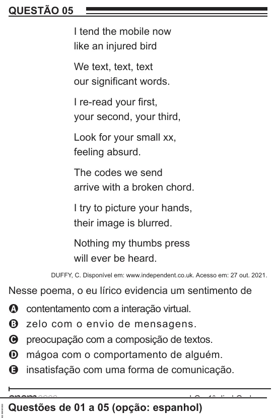

Texto extraído (pode conter ruído)

QUESTÃO 05  
I tend the mobile now  
like an injured bird  
We text, text, text  
our significant words.  
I re-read your first,  
your second, your third,  
Look for your small xx,  
feeling absurd.  
The codes we send  
arrive with a broken chord.  
I try to picture your hands,  
their image is blurred.  
Nothing my thumbs press  
will ever be heard.  
DUFFY, C. Disponível em: www.independent.co.uk. Acesso em: 27 out. 2021.  
Nesse poema, o eu lírico evidencia um sentimento de  
A  
contentamento com a interação virtual.  
zelo com o envio de mensagens.  
B  
preocupação com a composição de textos.  
C  
mágoa com o comportamento de alguém.  
D  
insatisfação com uma forma de comunicação.  
E  
Questões de 01 a 05 (opção: espanhol)

