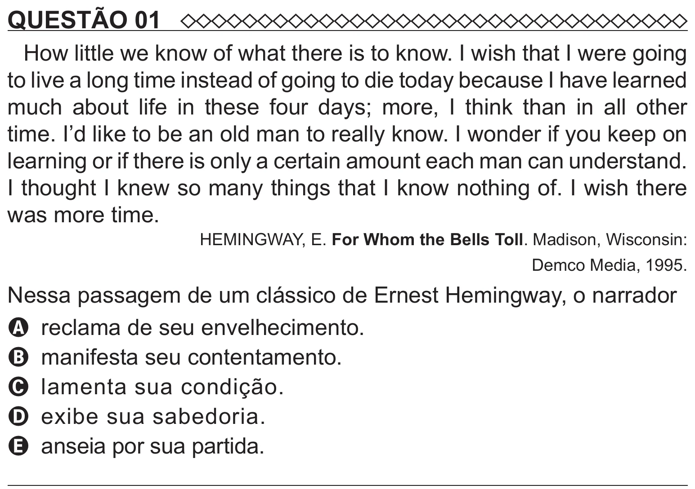

Texto extraído (pode conter ruído)

QUESTÃO 01  
How little we know of what there is to know. I wish that I were going  
to live a long time instead of going to die today because I have learned  
much about life in these four days; more, I think than in all other  
time. I’d like to be an old man to really know. I wonder if you keep on  
learning or if there is only a certain amount each man can understand.  
I thought I knew so many things that I know nothing of. I wish there  
was more time.  
HEMINGWAY, E. For Whom the Bells Toll. Madison, Wisconsin:  
Demco Media, 1995.  
Nessa passagem de um clássico de Ernest Hemingway, o narrador  
A reclama de seu envelhecimento.  
B manifesta seu contentamento.  
C lamenta sua condição.  
D exibe sua sabedoria.  
E anseia por sua partida.

