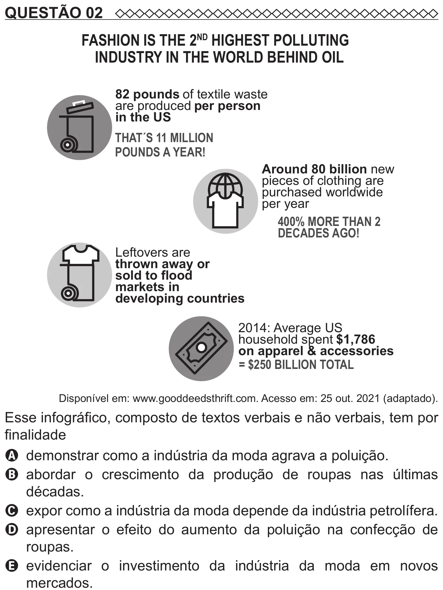

Texto extraído (pode conter ruído)

QUESTÃO 02  
FASHION IS THE 2 ND HIGHEST POLLUTING  
INDUSTRY IN THE WORLD BEHIND OIL  
82 pounds of textile waste  
are produced per person  
in the US  
THAT´S 11 MILLION  
POUNDS A YEAR!  
Around 80 billion new  
pieces of clothing are  
purchased worldwide  
per year  
400% MORE THAN 2  
DECADES AGO!  
Leftovers are  
thrown away or  
sold to flood  
markets in  
developing countries  
2014: Average US  
household spent $1,786  
on apparel & accessories  
= $250 BILLION TOTAL  
Disponível em: www.gooddeedsthrift.com. Acesso em: 25 out. 2021 (adaptado).  
Esse infográfico, composto de textos verbais e não verbais, tem por  
finalidade  
A demonstrar como a indústria da moda agrava a poluição.  
B   
abordar o crescimento da produção de roupas nas últimas  
décadas.  
C expor como a indústria da moda depende da indústria petrolífera.  
D apresentar o efeito do aumento da poluição na confecção de  
roupas.  
E   
evidenciar o investimento da indústria da moda em novos  
mercados.

