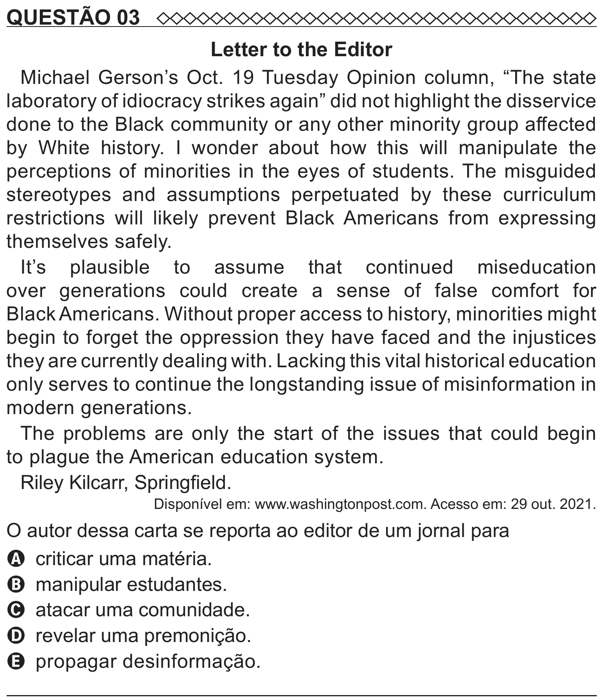

Texto extraído (pode conter ruído)

QUESTÃO 03  
Letter to the Editor  
Michael Gerson’s Oct. 19 Tuesday Opinion column, “The state  
laboratory of idiocracy strikes again” did not highlight the disservice  
done to the Black community or any other minority group affected  
by White history. I wonder about how this will manipulate the  
perceptions of minorities in the eyes of students. The misguided  
stereotypes and assumptions perpetuated by these curriculum  
restrictions will likely prevent Black Americans from expressing  
themselves safely.  
It’s plausible to assume that continued miseducation  
over generations could create a sense of false comfort for  
Black Americans. Without proper access to history, minorities might  
begin to forget the oppression they have faced and the injustices  
they are currently dealing with. Lacking this vital historical education  
only serves to continue the longstanding issue of misinformation in  
modern generations.  
The problems are only the start of the issues that could begin  
to plague the American education system.  
Riley Kilcarr, Springfield.  
Disponível em: www.washingtonpost.com. Acesso em: 29 out. 2021.  
O autor dessa carta se reporta ao editor de um jornal para  
A criticar uma matéria.  
B manipular estudantes.  
C atacar uma comunidade.  
D revelar uma premonição.  
E propagar desinformação.

