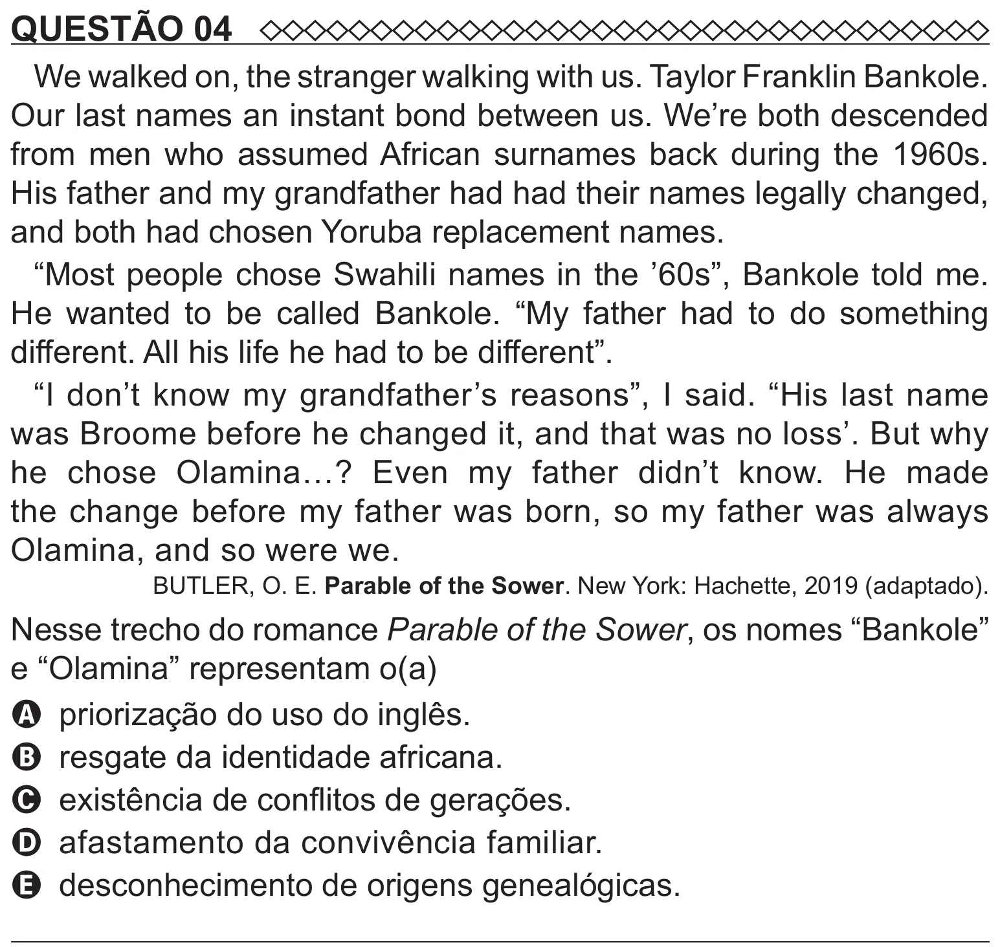

Texto extraído (pode conter ruído)

QUESTÃO 04  
We walked on, the stranger walking with us. Taylor Franklin Bankole.  
Our last names an instant bond between us. We’re both descended  
from men who assumed African surnames back during the 1960s.  
His father and my grandfather had had their names legally changed,  
and both had chosen Yoruba replacement names.  
“Most people chose Swahili names in the ’60s”, Bankole told me.  
He wanted to be called Bankole. “My father had to do something  
different. All his life he had to be different”.  
“I don’t know my grandfather’s reasons”, I said. “His last name  
was Broome before he changed it, and that was no loss’. But why  
he chose Olamina…? Even my father didn’t know. He made  
the change before my father was born, so my father was always  
Olamina, and so were we.  
BUTLER, O. E. Parable of the Sower. New York: Hachette, 2019 (adaptado).  
Nesse trecho do romance Parable of the Sower, os nomes “Bankole”  
e “Olamina” representam o(a)  
A priorização do uso do inglês.  
B resgate da identidade africana.  
C existência de conflitos de gerações.  
D afastamento da convivência familiar.  
E desconhecimento de origens genealógicas.

