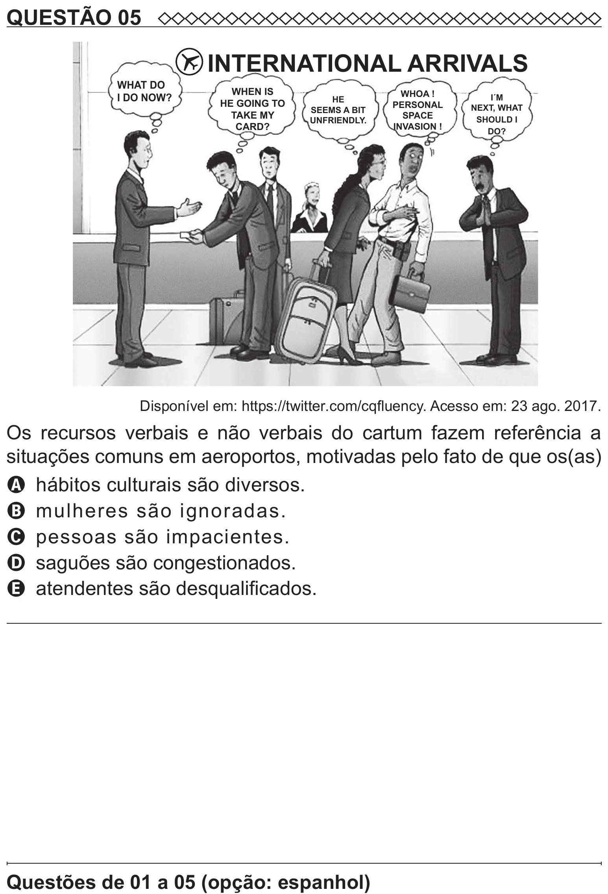

Texto extraído (pode conter ruído)

QUESTÃO 05  
INTERNATIONAL ARRIVALS  
WHAT DO  
WHEN IS  
WHOA !  
I DO NOW?  
I´M  
HE  
HE GOING TO  
PERSONAL  
NEXT, WHAT  
SEEMS A BIT  
TAKE MY  
SPACE  
SHOULD I  
UNFRIENDLY.  
CARD?  
INVASION !  
DO?  
Disponível em: https://twitter.com/cqfluency. Acesso em: 23 ago. 2017.  
Os recursos verbais e não verbais do cartum fazem referência a  
situações comuns em aeroportos, motivadas pelo fato de que os(as)  
A hábitos culturais são diversos.  
B mulheres são ignoradas.  
C pessoas são impacientes.  
D saguões são congestionados.  
E atendentes são desqualificados.

