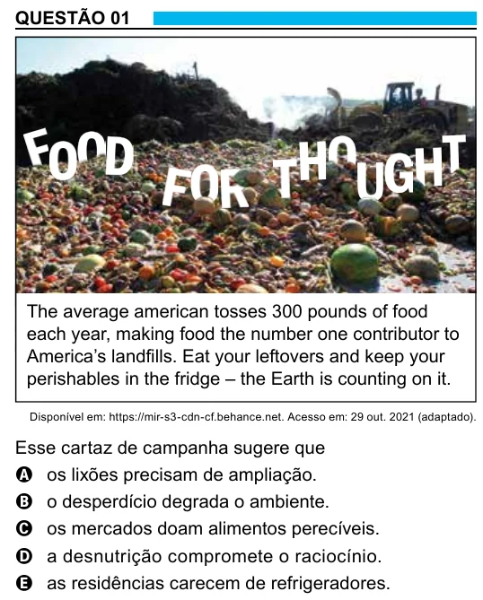

Texto extraído (pode conter ruído)

QUESTÃO 01  
The average american tosses 300 pounds of food  
each year, making food the number one contributor to  
America’s landfills. Eat your leftovers and keep your  
perishables in the fridge – the Earth is counting on it.  
Disponível em: https://mir-s3-cdn-cf.behance.net. Acesso em: 29 out. 2021 (adaptado).  
Esse cartaz de campanha sugere que  
A os lixões precisam de ampliação.  
B o desperdício degrada o ambiente.  
C os mercados doam alimentos perecíveis.  
D a desnutrição compromete o raciocínio.  
E as residências carecem de refrigeradores.

