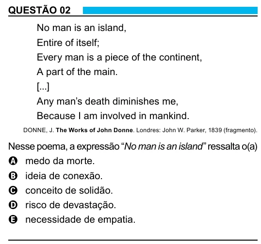

Texto extraído (pode conter ruído)

QUESTÃO 02  
No man is an island,  
Entire of itself;  
Every man is a piece of the continent,  
A part of the main.  
[...]  
Any man’s death diminishes me,  
Because I am involved in mankind.  
DONNE, J. The Works of John Donne. Londres: John W. Parker, 1839 (fragmento).  
Nesse poema, a expressão “No man is an island ” ressalta o(a)  
A medo da morte.  
B ideia de conexão.  
C conceito de solidão.  
D risco de devastação.  
E necessidade de empatia.  
2

