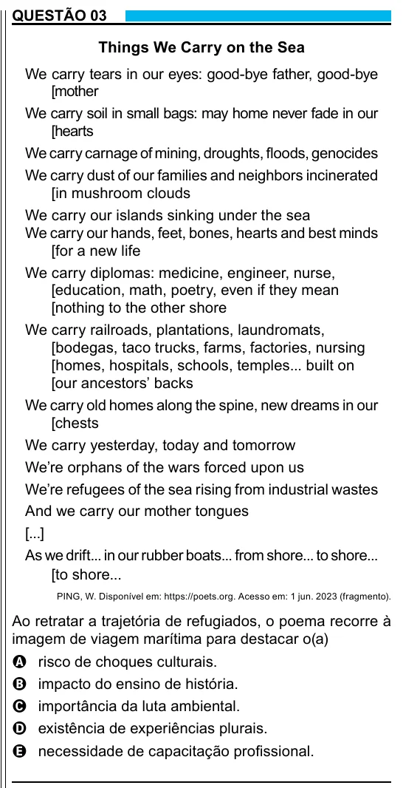

Texto extraído (pode conter ruído)

QUESTÃO 03  
Things We Carry on the Sea  
We carry tears in our eyes: good-bye father, good-bye  
[mother  
We carry soil in small bags: may home never fade in our  
[hearts  
We carry carnage of mining, droughts, floods, genocides  
We carry dust of our families and neighbors incinerated  
[in mushroom clouds  
We carry our islands sinking under the sea  
We carry our hands, feet, bones, hearts and best minds  
[for a new life  
We carry diplomas: medicine, engineer, nurse,  
[education, math, poetry, even if they mean  
[nothing to the other shore  
We carry railroads, plantations, laundromats,  
[bodegas, taco trucks, farms, factories, nursing  
[homes, hospitals, schools, temples... built on  
[our ancestors’ backs  
We carry old homes along the spine, new dreams in our  
[chests  
We carry yesterday, today and tomorrow  
We’re orphans of the wars forced upon us  
We’re refugees of the sea rising from industrial wastes  
And we carry our mother tongues  
[...]  
As we drift... in our rubber boats... from shore... to shore...  
[to shore...  
PING, W. Disponível em: https://poets.org. Acesso em: 1 jun. 2023 (fragmento).  
Ao retratar a trajetória de refugiados, o poema recorre à  
imagem de viagem marítima para destacar o(a)  
A risco de choques culturais.  
B impacto do ensino de história.  
C importância da luta ambiental.  
D existência de experiências plurais.  
E necessidade de capacitação profissional.

