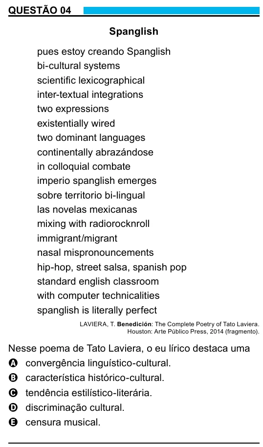

Texto extraído (pode conter ruído)

QUESTÃO 04  
Spanglish  
pues estoy creando Spanglish  
bi-cultural systems  
scientific lexicographical  
inter-textual integrations  
two expressions  
existentially wired  
two dominant languages  
continentally abrazándose  
in colloquial combate  
imperio spanglish emerges  
sobre territorio bi-lingual  
las novelas mexicanas  
mixing with radiorocknroll  
immigrant/migrant  
nasal mispronouncements  
hip-hop, street salsa, spanish pop  
standard english classroom  
with computer technicalities  
spanglish is literally perfect  
LAVIERA, T. Benedición: The Complete Poetry of Tato Laviera.  
Houston: Arte Público Press, 2014 (fragmento).  
Nesse poema de Tato Laviera, o eu lírico destaca uma  
A convergência linguístico-cultural.  
B característica histórico-cultural.  
C tendência estilístico-literária.  
D discriminação cultural.  
E censura musical.

