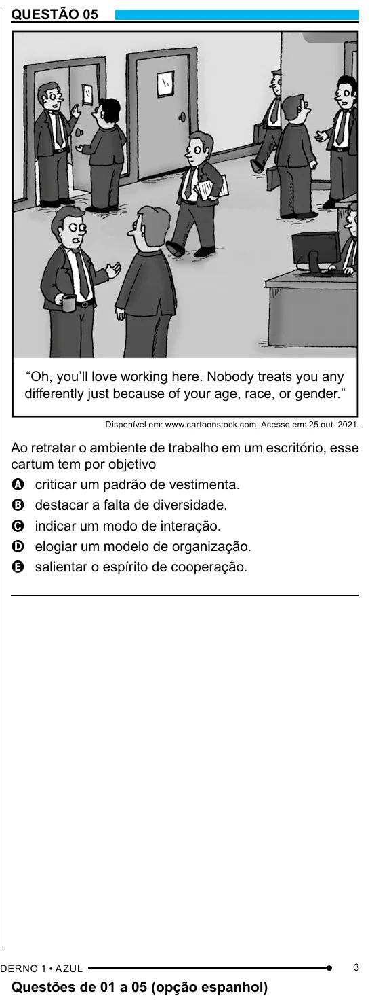

Texto extraído (pode conter ruído)

QUESTÃO 05  
“Oh, you’ll love working here. Nobody treats you any  
differently just because of your age, race, or gender.”  
Disponível em: www.cartoonstock.com. Acesso em: 25 out. 2021.  
Ao retratar o ambiente de trabalho em um escritório, esse  
cartum tem por objetivo  
A criticar um padrão de vestimenta.  
B destacar a falta de diversidade.  
C indicar um modo de interação.  
D elogiar um modelo de organização.  
E salientar o espírito de cooperação.  
3  
Questões de 01 a 05 (opção espanhol)

