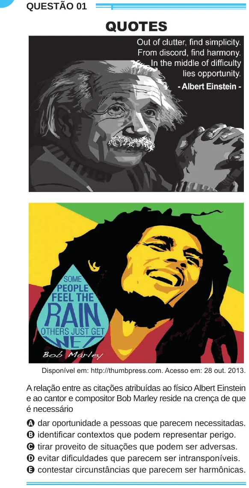

Texto extraído (pode conter ruído)

QUESTÃO 01  
Disponível em: http://thumbpress.com. Acesso em: 28 out. 2013.  
A relação entre as citações atribuídas ao físico Albert Einstein  
e ao cantor e compositor Bob Marley reside na crença de que  
é necessário  
A dar oportunidade a pessoas que parecem necessitadas.  
B identificar contextos que podem representar perigo.  
C tirar proveito de situações que podem ser adversas.  
D evitar dificuldades que parecem ser intransponíveis.  
E contestar circunstâncias que parecem ser harmônicas.

