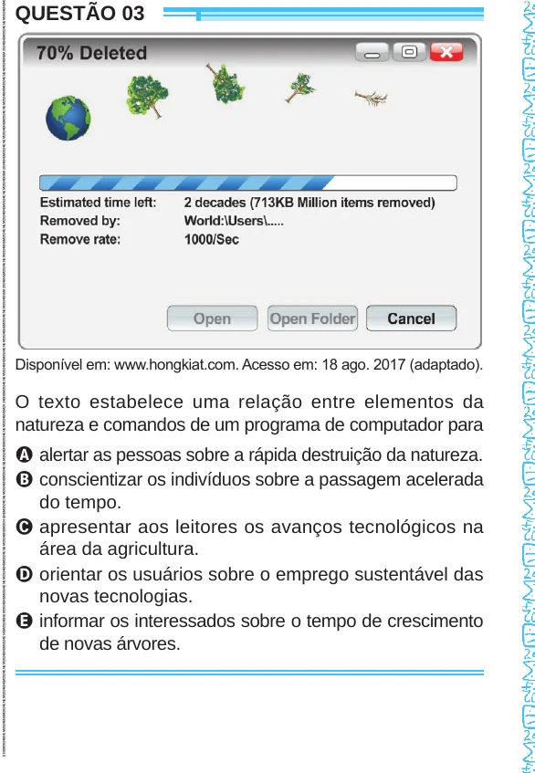

Texto extraído (pode conter ruído)

QUESTÃO 03  
Disponível em: www.hongkiat.com. Acesso em: 18 ago. 2017 (adaptado).  
O texto estabelece uma relação entre elementos da  
natureza e comandos de um programa de computador para  
A alertar as pessoas sobre a rápida destruição da natureza.  
B conscientizar os indivíduos sobre a passagem acelerada  
do tempo.  
C apresentar aos leitores os avanços tecnológicos na  
área da agricultura.  
D orientar os usuários sobre o emprego sustentável das  
novas tecnologias.  
E informar os interessados sobre o tempo de crescimento  
de novas árvores.

