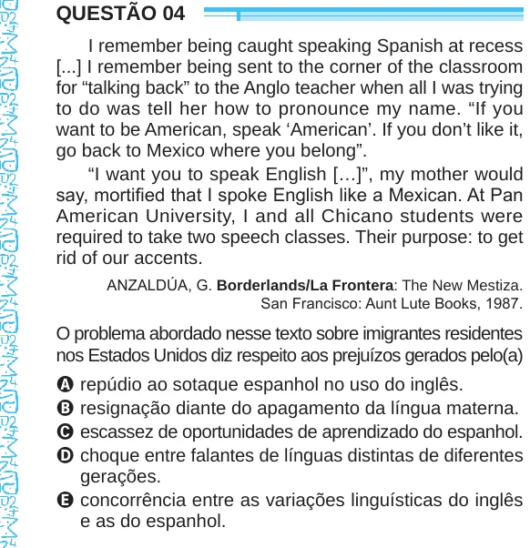

Texto extraído (pode conter ruído)

QUESTÃO 04  
I remember being caught speaking Spanish at recess  
[...] I remember being sent to the corner of the classroom  
for “talking back” to the Anglo teacher when all I was trying  
to do was tell her how to pronounce my name. “If you  
want to be American, speak ‘American’. If you don’t like it,  
go back to Mexico where you belong”.  
“I want you to speak English […]”, my mother would  
say, mortified that I spoke English like a Mexican. At Pan  
American University, I and all Chicano students were  
required to take two speech classes. Their purpose: to get  
rid of our accents.  
ANZALDÚA, G. Borderlands/La Frontera: The New Mestiza.  
San Francisco: Aunt Lute Books, 1987.  
O problema abordado nesse texto sobre imigrantes residentes  
nos Estados Unidos diz respeito aos prejuízos gerados pelo(a)  
A repúdio ao sotaque espanhol no uso do inglês.  
B resignação diante do apagamento da língua materna.  
C escassez de oportunidades de aprendizado do espanhol.  
D choque entre falantes de línguas distintas de diferentes  
gerações.  
E concorrência entre as variações linguísticas do inglês  
e as do espanhol.

