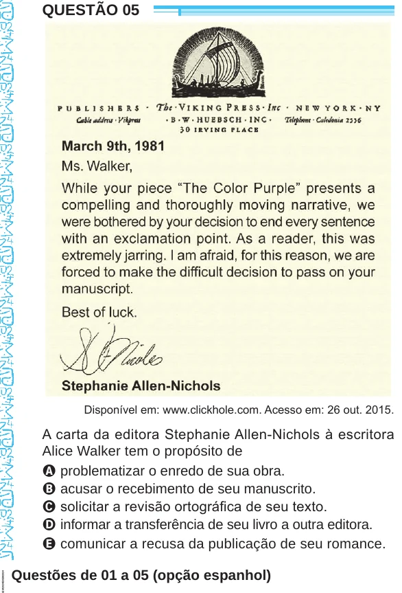

Texto extraído (pode conter ruído)

QUESTÃO 05  
Disponível em: www.clickhole.com. Acesso em: 26 out. 2015.  
A carta da editora Stephanie Allen-Nichols à escritora  
Alice Walker tem o propósito de  
A problematizar o enredo de sua obra.  
B acusar o recebimento de seu manuscrito.  
C solicitar a revisão ortográfica de seu texto.  
D informar a transferência de seu livro a outra editora.  
E comunicar a recusa da publicação de seu romance.  
Questões de 01 a 05 (opção espanhol)

