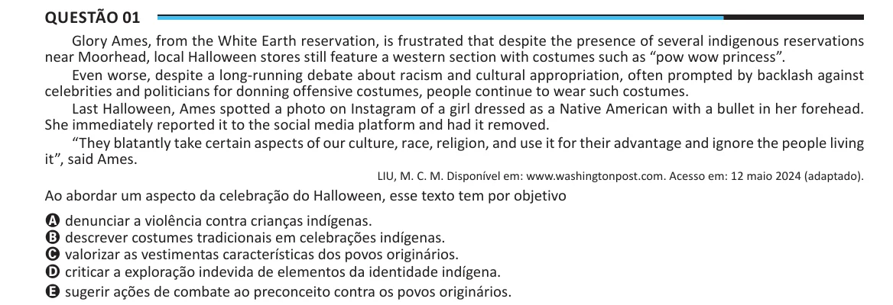

Texto extraído (pode conter ruído)

Questão 01  
Glory Ames, from the White Earth reservation, is frustrated that despite the presence of several indigenous reservations  
near Moorhead, local Halloween stores still feature a western section with costumes such as “pow wow princess”.  
Even worse, despite a long-running debate about racism and cultural appropriation, often prompted by backlash against  
celebrities and politicians for donning offensive costumes, people continue to wear such costumes.  
Last Halloween, Ames spotted a photo on Instagram of a girl dressed as a Native American with a bullet in her forehead.  
She immediately reported it to the social media platform and had it removed.  
“They blatantly take certain aspects of our culture, race, religion, and use it for their advantage and ignore the people living  
it”, said Ames.  
LIU, M. C. M. Disponível em: www.washingtonpost.com. Acesso em: 12 maio 2024 (adaptado).  
Ao abordar um aspecto da celebração do Halloween, esse texto tem por objetivo  
A denunciar a violência contra crianças indígenas.  
B descrever costumes tradicionais em celebrações indígenas.  
C valorizar as vestimentas características dos povos originários.  
D criticar a exploração indevida de elementos da identidade indígena.  
E sugerir ações de combate ao preconceito contra os povos originários.

