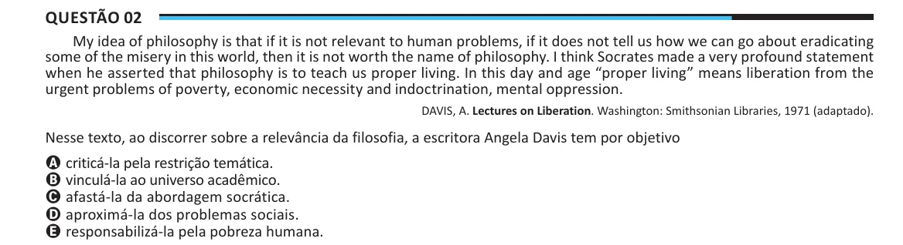

Texto extraído (pode conter ruído)

Questão 02  
My idea of philosophy is that if it is not relevant to human problems, if it does not tell us how we can go about eradicating  
some of the misery in this world, then it is not worth the name of philosophy. I think Socrates made a very profound statement  
when he asserted that philosophy is to teach us proper living. In this day and age “proper living” means liberation from the  
urgent problems of poverty, economic necessity and indoctrination, mental oppression.  
DAVIS, A. Lectures on Liberation. Washington: Smithsonian Libraries, 1971 (adaptado).  
Nesse texto, ao discorrer sobre a relevância da filosofia, a escritora Angela Davis tem por objetivo  
A criticá-la pela restrição temática.  
B vinculá-la ao universo acadêmico.  
C afastá-la da abordagem socrática.  
D aproximá-la dos problemas sociais.  
E responsabilizá-la pela pobreza humana.

