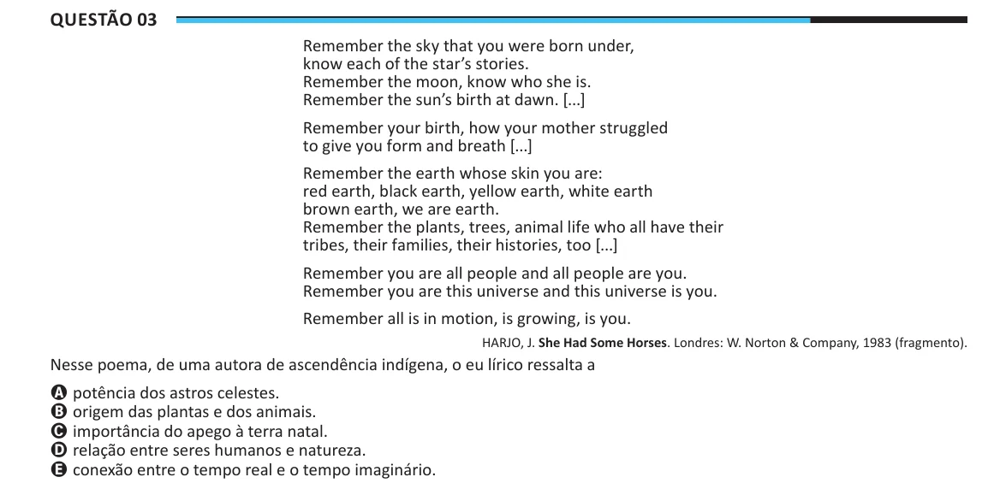

Texto extraído (pode conter ruído)

Questão 03  
Remember the sky that you were born under,  
know each of the star’s stories.  
Remember the moon, know who she is.  
Remember the sun’s birth at dawn. [...]  
Remember your birth, how your mother struggled  
to give you form and breath [...]  
Remember the earth whose skin you are:  
red earth, black earth, yellow earth, white earth  
brown earth, we are earth.  
Remember the plants, trees, animal life who all have their  
tribes, their families, their histories, too [...]  
Remember you are all people and all people are you.  
Remember you are this universe and this universe is you.  
Remember all is in motion, is growing, is you.  
HARJO, J. She Had Some Horses. Londres: W. Norton & Company, 1983 (fragmento).  
Nesse poema, de uma autora de ascendência indígena, o eu lírico ressalta a  
A potência dos astros celestes.  
B origem das plantas e dos animais.  
C importância do apego à terra natal.  
D relação entre seres humanos e natureza.  
E conexão entre o tempo real e o tempo imaginário.

