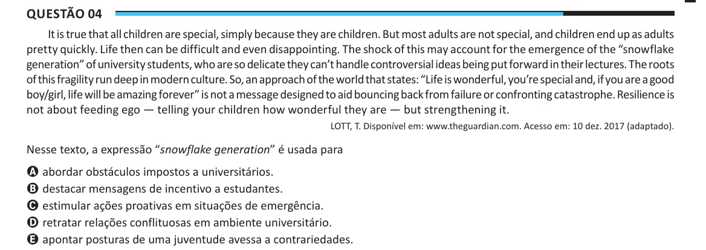

Texto extraído (pode conter ruído)

Questão 04  
It is true that all children are special, simply because they are children. But most adults are not special, and children end up as adults  
pretty quickly. Life then can be difficult and even disappointing. The shock of this may account for the emergence of the “snowflake  
generation” of university students, who are so delicate they can’t handle controversial ideas being put forward in their lectures. The roots  
of this fragility run deep in modern culture. So, an approach of the world that states: “Life is wonderful, you’re special and, if you are a good  
boy/girl, life will be amazing forever” is not a message designed to aid bouncing back from failure or confronting catastrophe. Resilience is  
not about feeding ego — telling your children how wonderful they are — but strengthening it.  
LOTT, T. Disponível em: www.theguardian.com. Acesso em: 10 dez. 2017 (adaptado).  
Nesse texto, a expressão “snowflake generation” é usada para  
A abordar obstáculos impostos a universitários.  
B destacar mensagens de incentivo a estudantes.  
C estimular ações proativas em situações de emergência.  
D retratar relações conflituosas em ambiente universitário.  
E apontar posturas de uma juventude avessa a contrariedades.

