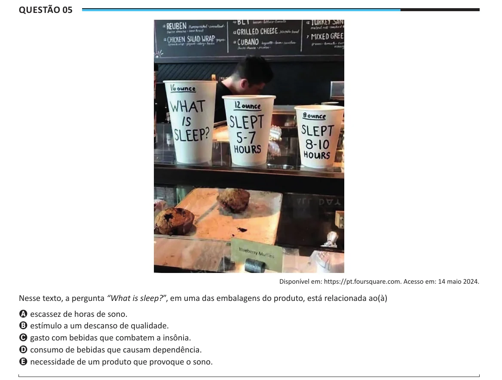

Texto extraído (pode conter ruído)

Questão 05  
Disponível em: https://pt.foursquare.com. Acesso em: 14 maio 2024.  
Nesse texto, a pergunta “What is sleep?”, em uma das embalagens do produto, está relacionada ao(à)  
A escassez de horas de sono.  
B estímulo a um descanso de qualidade.  
C gasto com bebidas que combatem a insônia.  
D consumo de bebidas que causam dependência.  
E necessidade de um produto que provoque o sono.

