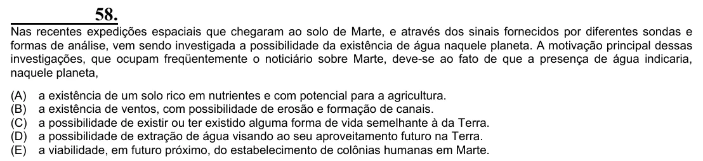

Texto extraído (pode conter ruído)

58.  
Nas recentes expedições espaciais que chegaram ao solo de Marte, e através dos sinais fornecidos por diferentes sondas e  
formas de análise, vem sendo investigada a possibilidade da existência de água naquele planeta. A motivação principal dessas  
investigações, que ocupam freqüentemente o noticiário sobre Marte, deve-se ao fato de que a presença de água indicaria,  
naquele planeta,  
(A)  
a existência de um solo rico em nutrientes e com potencial para a agricultura.  
(B)  
a existência de ventos, com possibilidade de erosão e formação de canais.  
(C)  
a possibilidade de existir ou ter existido alguma forma de vida semelhante à da Terra.  
(D)  
a possibilidade de extração de água visando ao seu aproveitamento futuro na Terra.  
(E)  
a viabilidade, em futuro próximo, do estabelecimento de colônias humanas em Marte.

