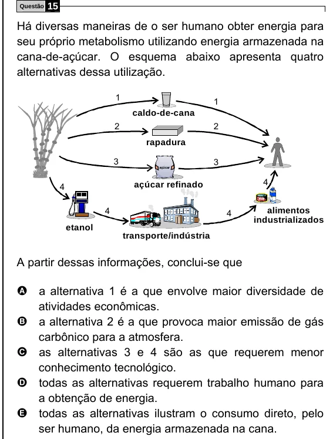

Texto extraído (pode conter ruído)

Questão  
15  
Há diversas maneiras de o ser humano obter energia para  
seu próprio metabolismo utilizando energia armazenada na  
cana-de-açúcar. O esquema abaixo apresenta quatro  
alternativas dessa utilização.  
1  
1  
caldo-de-cana  
2  
2  
rapadura  
3  
3  
açúcar  
4  
4  
açúcar refinado  
4  
alimentos  
4  
industrializados  
etanol  
transporte/indústria  
A partir dessas informações, conclui-se que  
A a alternativa 1 é a que envolve maior diversidade de  
atividades econômicas.  
B a alternativa 2 é a que provoca maior emissão de gás  
carbônico para a atmosfera.  
C as alternativas 3 e 4 são as que requerem menor  
conhecimento tecnológico.  
D todas as alternativas requerem trabalho humano para  
a obtenção de energia.  
E todas as alternativas ilustram o consumo direto, pelo  
ser humano, da energia armazenada na cana.

