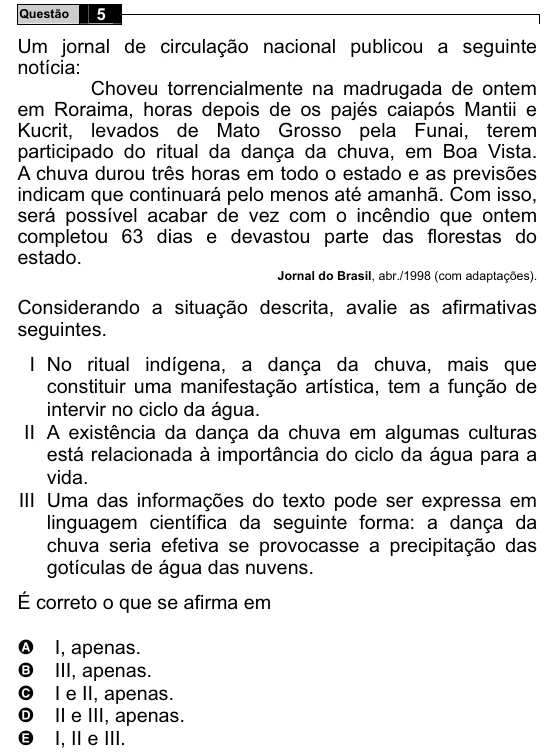

Texto extraído (pode conter ruído)

Questão  
5  
Um jornal de circulação nacional publicou a seguinte  
notícia:  
Choveu torrencialmente na madrugada de ontem  
em Roraima, horas depois de os pajés caiapós Mantii e  
Kucrit, levados de Mato Grosso pela Funai, terem  
participado do ritual da dança da chuva, em Boa Vista.  
A chuva durou três horas em todo o estado e as previsões  
indicam que continuará pelo menos até amanhã. Com isso,  
será possível acabar de vez com o incêndio que ontem  
completou 63 dias e devastou parte das florestas do  
estado.  
Jornal do Brasil, abr./1998 (com adaptações).  
Considerando a situação descrita, avalie as afirmativas  
seguintes.  
I No ritual indígena, a dança da chuva, mais que  
constituir uma manifestação artística, tem a função de  
intervir no ciclo da água.  
II A existência da dança da chuva em algumas culturas  
está relacionada à importância do ciclo da água para a  
vida.  
III Uma das informações do texto pode ser expressa em  
linguagem científica da seguinte forma: a dança da  
chuva seria efetiva se provocasse a precipitação das  
gotículas de água das nuvens.  
É correto o que se afirma em  
I, apenas.  
A  
B  
III, apenas.  
I e II, apenas.  
C  
D  
II e III, apenas.  
E  
I, II e III.

