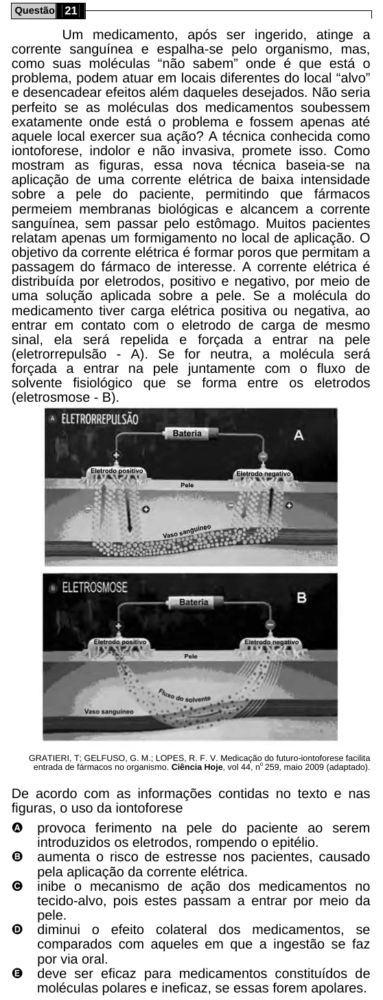

Texto extraído (pode conter ruído)

Questão 21  
Um medicamento, após ser ingerido, atinge a  
corrente sanguínea e espalha-se pelo organismo, mas,  
como suas moléculas “não sabem” onde é que está o  
problema, podem atuar em locais diferentes do local “alvo”  
e desencadear efeitos além daqueles desejados. Não seria  
perfeito se as moléculas dos medicamentos soubessem  
exatamente onde está o problema e fossem apenas até  
aquele local exercer sua ação? A técnica conhecida como  
iontoforese, indolor e não invasiva, promete isso. Como  
mostram as figuras, essa nova técnica baseia-se na  
aplicação de uma corrente elétrica de baixa intensidade  
sobre a pele do paciente, permitindo que fármacos  
permeiem membranas biológicas e alcancem a corrente  
sanguínea, sem passar pelo estômago. Muitos pacientes  
relatam apenas um formigamento no local de aplicação. O  
objetivo da corrente elétrica é formar poros que permitam a  
passagem do fármaco de interesse. A corrente elétrica é  
distribuída por eletrodos, positivo e negativo, por meio de  
uma solução aplicada sobre a pele. Se a molécula do  
medicamento tiver carga elétrica positiva ou negativa, ao  
entrar em contato com o eletrodo de carga de mesmo  
sinal, ela será repelida e forçada a entrar na pele  
(eletrorrepulsão - A). Se for neutra, a molécula será  
forçada a entrar na pele juntamente com o fluxo de  
solvente fisiológico que se forma entre os eletrodos  
(eletrosmose - B).  
GRATIERI, T; GELFUSO, G. M.; LOPES, R. F. V. Medicação do futuro-iontoforese facilita  
entrada de fármacos no organismo. Ciência Hoje, vol 44, n 259, maio 2009 (adaptado).  
o  
De acordo com as informações contidas no texto e nas  
figuras, o uso da iontoforese  
A provoca ferimento na pele do paciente ao serem  
introduzidos os eletrodos, rompendo o epitélio.  
B aumenta o risco de estresse nos pacientes, causado  
pela aplicação da corrente elétrica.  
C inibe o mecanismo de ação dos medicamentos no  
tecido-alvo, pois estes passam a entrar por meio da  
pele.  
D diminui o efeito colateral dos medicamentos, se  
comparados com aqueles em que a ingestão se faz  
por via oral.  
E deve ser eficaz para medicamentos constituídos de  
moléculas polares e ineficaz, se essas forem apolares.

