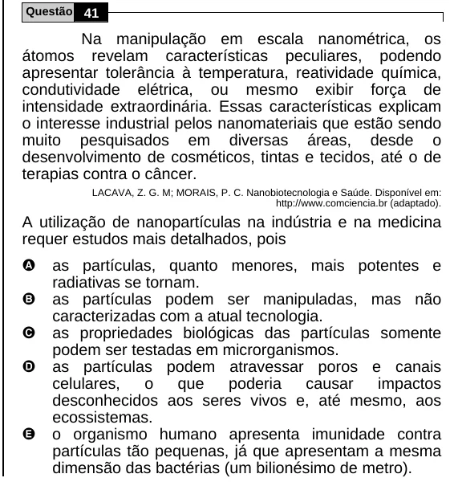

Texto extraído (pode conter ruído)

Questão 41  
Na manipulação em escala nanométrica, os  
átomos revelam características peculiares, podendo  
apresentar tolerância à temperatura, reatividade química,  
condutividade elétrica, ou mesmo exibir força de  
intensidade extraordinária. Essas características explicam  
o interesse industrial pelos nanomateriais que estão sendo  
muito pesquisados em diversas áreas, desde o  
desenvolvimento de cosméticos, tintas e tecidos, até o de  
terapias contra o câncer.  
LACAVA, Z. G. M; MORAIS, P. C. Nanobiotecnologia e Saúde. Disponível em:  
http://www.comciencia.br (adaptado).  
A utilização de nanopartículas na indústria e na medicina  
requer estudos mais detalhados, pois  
A  
as partículas, quanto menores, mais potentes e  
radiativas se tornam.  
B  
as partículas podem ser manipuladas, mas não  
caracterizadas com a atual tecnologia.  
C  
as propriedades biológicas das partículas somente  
podem ser testadas em microrganismos.  
D  
as partículas podem atravessar poros e canais  
celulares,  
o  
que  
poderia  
causar  
impactos  
desconhecidos aos seres vivos e, até mesmo, aos  
ecossistemas.  
E  
o organismo humano apresenta imunidade contra  
partículas tão pequenas, já que apresentam a mesma  
dimensão das bactérias (um bilionésimo de metro).

