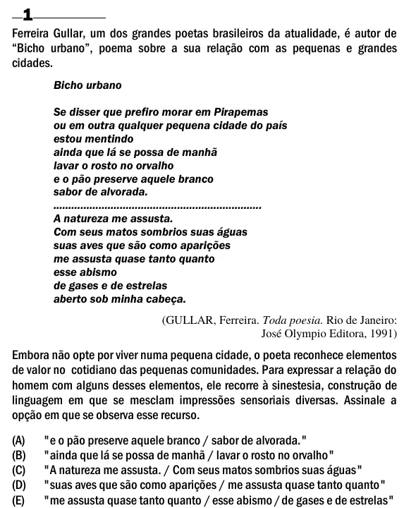

Texto extraído (pode conter ruído)

1  
Ferreira Gullar, um dos grandes poetas brasileiros da atualidade, é autor de  
“Bicho urbano”, poema sobre a sua relação com as pequenas e grandes  
cidades.  
Bicho urbano  
Se disser que prefiro morar em Pirapemas  
ou em outra qualquer pequena cidade do país  
estou mentindo  
ainda que lá se possa de manhã  
lavar o rosto no orvalho  
e o pão preserve aquele branco  
sabor de alvorada.  
.....................................................................  
A natureza me assusta.  
Com seus matos sombrios suas águas  
suas aves que são como aparições  
me assusta quase tanto quanto  
esse abismo  
de gases e de estrelas  
aberto sob minha cabeça.  
(GULLAR, Ferreira. Toda poesia. Rio de Janeiro:  
José Olympio Editora, 1991)  
Embora não opte por viver numa pequena cidade, o poeta reconhece elementos  
de valor no cotidiano das pequenas comunidades. Para expressar a relação do  
homem com alguns desses elementos, ele recorre à sinestesia, construção de  
linguagem em que se mesclam impressões sensoriais diversas. Assinale a  
opção em que se observa esse recurso.  
(A)  
"e o pão preserve aquele branco / sabor de alvorada."  
(B)  
"ainda que lá se possa de manhã / lavar o rosto no orvalho"  
(C)  
"A natureza me assusta. / Com seus matos sombrios suas águas"  
(D)  
"suas aves que são como aparições / me assusta quase tanto quanto"  
(E)  
"me assusta quase tanto quanto / esse abismo / de gases e de estrelas"

