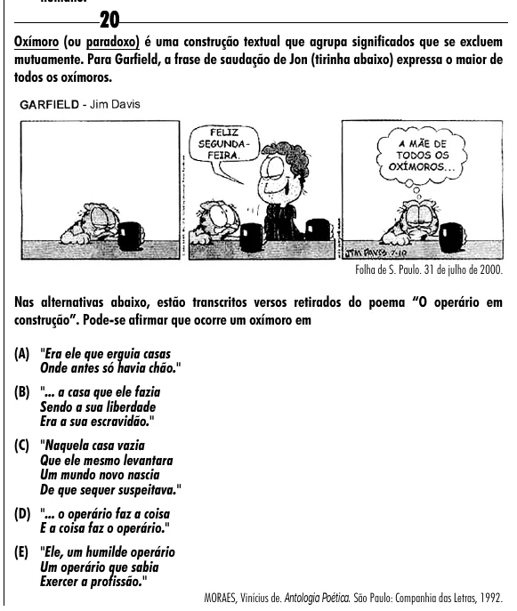

Texto extraído (pode conter ruído)

20  
Oxímoro (ou paradoxo) é uma construção textual que agrupa significados que se excluem  
mutuamente. Para Garfield, a frase de saudação de Jon (tirinha abaixo) expressa o maior de  
todos os oxímoros.  
Folha de S. Paulo. 31 de julho de 2000.  
Nas alternativas abaixo, estão transcritos versos retirados do poema “O operário em  
construção”. Pode-se afirmar que ocorre um oxímoro em  
(A) "Era ele que erguia casas  
Onde antes só havia chão."  
(B) "... a casa que ele fazia  
Sendo a sua liberdade  
Era a sua escravidão."  
(C) "Naquela casa vazia  
Que ele mesmo levantara  
Um mundo novo nascia  
De que sequer suspeitava."  
(D) "... o operário faz a coisa  
E a coisa faz o operário."  
(E) "Ele, um humilde operário  
Um operário que sabia  
Exercer a profissão."  
MORAES, Vinícius de. Antologia Poética. São Paulo: Companhia das Letras, 1992.

