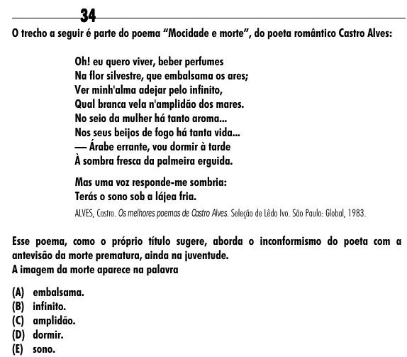

Texto extraído (pode conter ruído)

34  
O trecho a seguir é parte do poema “Mocidade e morte”, do poeta romântico Castro Alves:  
Oh! eu quero viver, beber perfumes  
Na flor silvestre, que embalsama os ares;  
Ver minh'alma adejar pelo infinito,  
Qual branca vela n'amplidão dos mares.  
No seio da mulher há tanto aroma...  
Nos seus beijos de fogo há tanta vida...  
–– Árabe errante, vou dormir à tarde  
À sombra fresca da palmeira erguida.  
Mas uma voz responde-me sombria:  
Terás o sono sob a lájea fria.  
ALVES, Castro. Os melhores poemas de Castro Alves. Seleção de Lêdo Ivo. São Paulo: Global, 1983.  
Esse poema, como o próprio título sugere, aborda o inconformismo do poeta com a  
antevisão da morte prematura, ainda na juventude.  
A imagem da morte aparece na palavra  
(A) embalsama.  
(B) infinito.  
(C) amplidão.  
(D) dormir.  
(E) sono.

