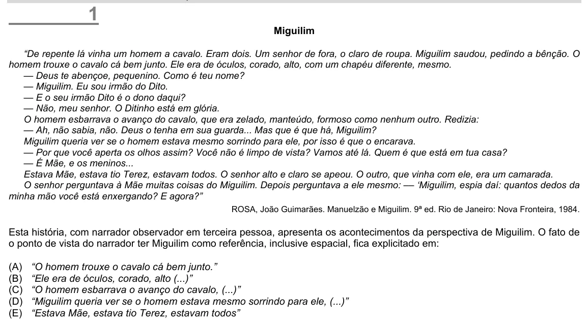

Texto extraído (pode conter ruído)

1  
Miguilim  
“De repente lá vinha um homem a cavalo. Eram dois. Um senhor de fora, o claro de roupa. Miguilim saudou, pedindo a bênção. O  
homem trouxe o cavalo cá bem junto. Ele era de óculos, corado, alto, com um chapéu diferente, mesmo.  
— Deus te abençoe, pequenino. Como é teu nome?  
— Miguilim. Eu sou irmão do Dito.  
— E o seu irmão Dito é o dono daqui?  
— Não, meu senhor. O Ditinho está em glória.  
O homem esbarrava o avanço do cavalo, que era zelado, manteúdo, formoso como nenhum outro. Redizia:  
— Ah, não sabia, não. Deus o tenha em sua guarda... Mas que é que há, Miguilim?  
Miguilim queria ver se o homem estava mesmo sorrindo para ele, por isso é que o encarava.  
— Por que você aperta os olhos assim? Você não é limpo de vista? Vamos até lá. Quem é que está em tua casa?  
— É Mãe, e os meninos...  
Estava Mãe, estava tio Terez, estavam todos. O senhor alto e claro se apeou. O outro, que vinha com ele, era um camarada.  
O senhor perguntava à Mãe muitas coisas do Miguilim. Depois perguntava a ele mesmo: –– ‘Miguilim, espia daí: quantos dedos da  
minha mão você está enxergando? E agora?”  
ROSA, João Guimarães. Manuelzão e Miguilim. 9ª ed. Rio de Janeiro: Nova Fronteira, 1984.  
Esta história, com narrador observador em terceira pessoa, apresenta os acontecimentos da perspectiva de Miguilim. O fato de  
o ponto de vista do narrador ter Miguilim como referência, inclusive espacial, fica explicitado em:  
(A)  
“O homem trouxe o cavalo cá bem junto.”  
(B)  
“Ele era de óculos, corado, alto (...)”  
(C)  
“O homem esbarrava o avanço do cavalo, (...)”  
(D)  
“Miguilim queria ver se o homem estava mesmo sorrindo para ele, (...)”  
(E)  
“Estava Mãe, estava tio Terez, estavam todos”

