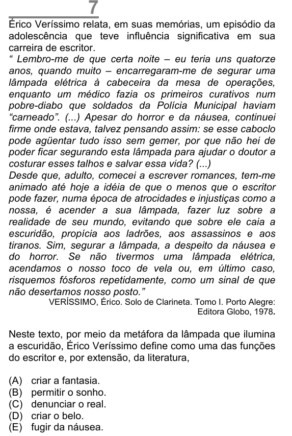

Texto extraído (pode conter ruído)

Érico Veríssimo relata, em suas memórias, um episódio da  
adolescência que teve influência significativa em sua  
carreira de escritor.  
“ Lembro-me de que certa noite – eu teria uns quatorze  
anos, quando muito – encarregaram-me de segurar uma  
lâmpada elétrica à cabeceira da mesa de operações,  
enquanto um médico fazia os primeiros curativos num  
pobre-diabo que soldados da Polícia Municipal haviam  
“carneado”. (...) Apesar do horror e da náusea, continuei  
firme onde estava, talvez pensando assim: se esse caboclo  
pode agüentar tudo isso sem gemer, por que não hei de  
poder ficar segurando esta lâmpada para ajudar o doutor a  
costurar esses talhos e salvar essa vida? (...)  
Desde que, adulto, comecei a escrever romances, tem-me  
animado até hoje a idéia de que o menos que o escritor  
pode fazer, numa época de atrocidades e injustiças como a  
nossa, é acender a sua lâmpada, fazer luz sobre a  
realidade de seu mundo, evitando que sobre ele caia a  
escuridão, propícia aos ladrões, aos assassinos e aos  
tiranos. Sim, segurar a lâmpada, a despeito da náusea e  
do horror. Se não tivermos uma lâmpada elétrica,  
acendamos o nosso toco de vela ou, em último caso,  
risquemos fósforos repetidamente, como um sinal de que  
não desertamos nosso posto.”  
VERÍSSIMO, Érico. Solo de Clarineta. Tomo I. Porto Alegre:  
Editora Globo, 1978.  
Neste texto, por meio da metáfora da lâmpada que ilumina  
a escuridão, Érico Veríssimo define como uma das funções  
do escritor e, por extensão, da literatura,  
(A)  
criar a fantasia.  
(B)  
permitir o sonho.  
(C)  
denunciar o real.  
(D)  
criar o belo.  
(E)  
fugir da náusea.

