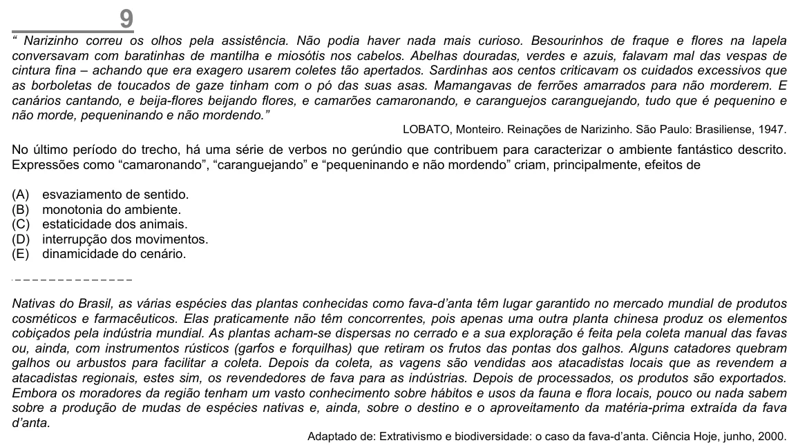

Texto extraído (pode conter ruído)

9  
“ Narizinho correu os olhos pela assistência. Não podia haver nada mais curioso. Besourinhos de fraque e flores na lapela  
conversavam com baratinhas de mantilha e miosótis nos cabelos. Abelhas douradas, verdes e azuis, falavam mal das vespas de  
cintura fina – achando que era exagero usarem coletes tão apertados. Sardinhas aos centos criticavam os cuidados excessivos que  
as borboletas de toucados de gaze tinham com o pó das suas asas. Mamangavas de ferrões amarrados para não morderem. E  
canários cantando, e beija-flores beijando flores, e camarões camaronando, e caranguejos caranguejando, tudo que é pequenino e  
não morde, pequeninando e não mordendo.”  
LOBATO, Monteiro. Reinações de Narizinho. São Paulo: Brasiliense, 1947.  
No último período do trecho, há uma série de verbos no gerúndio que contribuem para caracterizar o ambiente fantástico descrito.  
Expressões como “camaronando”, “caranguejando” e “pequeninando e não mordendo” criam, principalmente, efeitos de  
(A)  
esvaziamento de sentido.  
(B)  
monotonia do ambiente.  
(C)  
estaticidade dos animais.  
(D)  
interrupção dos movimentos.  
(E)  
dinamicidade do cenário.  
Nativas do Brasil, as várias espécies das plantas conhecidas como fava-d’anta têm lugar garantido no mercado mundial de produtos  
cosméticos e farmacêuticos. Elas praticamente não têm concorrentes, pois apenas uma outra planta chinesa produz os elementos  
cobiçados pela indústria mundial. As plantas acham-se dispersas no cerrado e a sua exploração é feita pela coleta manual das favas  
ou, ainda, com instrumentos rústicos (garfos e forquilhas) que retiram os frutos das pontas dos galhos. Alguns catadores quebram  
galhos ou arbustos para facilitar a coleta. Depois da coleta, as vagens são vendidas aos atacadistas locais que as revendem a  
atacadistas regionais, estes sim, os revendedores de fava para as indústrias. Depois de processados, os produtos são exportados.  
Embora os moradores da região tenham um vasto conhecimento sobre hábitos e usos da fauna e flora locais, pouco ou nada sabem  
sobre a produção de mudas de espécies nativas e, ainda, sobre o destino e o aproveitamento da matéria-prima extraída da fava  
d’anta.  
Adaptado de: Extrativismo e biodiversidade: o caso da fava-d’anta. Ciência Hoje, junho, 2000.

