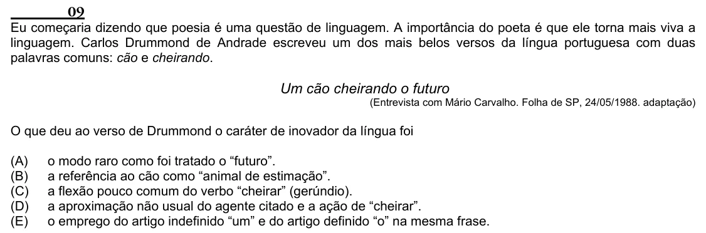

Texto extraído (pode conter ruído)

09  
Eu começaria dizendo que poesia é uma questão de linguagem. A importância do poeta é que ele torna mais viva a  
linguagem. Carlos Drummond de Andrade escreveu um dos mais belos versos da língua portuguesa com duas  
palavras comuns: cão e cheirando.  
Um cão cheirando o futuro  
(Entrevista com Mário Carvalho. Folha de SP, 24/05/1988. adaptação)  
O que deu ao verso de Drummond o caráter de inovador da língua foi  
(A)  
o modo raro como foi tratado o “futuro”.  
(B)  
a referência ao cão como “animal de estimação”.  
(C)  
a flexão pouco comum do verbo “cheirar” (gerúndio).  
(D)  
a aproximação não usual do agente citado e a ação de “cheirar”.  
(E)  
o emprego do artigo indefinido “um” e do artigo definido “o” na mesma frase.

