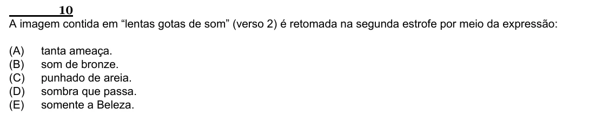

Texto extraído (pode conter ruído)

10  
A imagem contida em “lentas gotas de som” (verso 2) é retomada na segunda estrofe por meio da expressão:  
(A)  
tanta ameaça.  
(B)  
som de bronze.  
(C)  
punhado de areia.  
(D)  
sombra que passa.  
(E)  
somente a Beleza.

