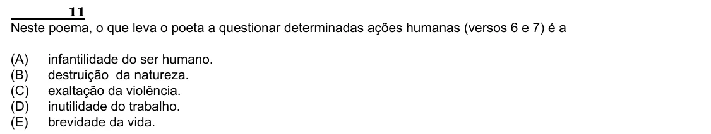

Texto extraído (pode conter ruído)

11  
Neste poema, o que leva o poeta a questionar determinadas ações humanas (versos 6 e 7) é a  
(A)  
infantilidade do ser humano.  
(B)  
destruição da natureza.  
(C)  
exaltação da violência.  
(D)  
inutilidade do trabalho.  
(E)  
brevidade da vida.

