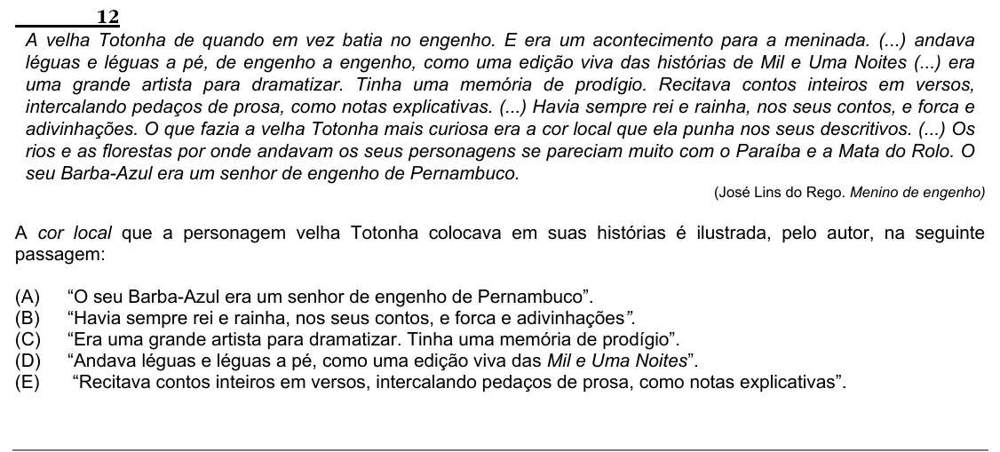

Texto extraído (pode conter ruído)

12  
A velha Totonha de quando em vez batia no engenho. E era um acontecimento para a meninada. (...) andava  
léguas e léguas a pé, de engenho a engenho, como uma edição viva das histórias de Mil e Uma Noites (...) era  
uma grande artista para dramatizar. Tinha uma memória de prodígio. Recitava contos inteiros em versos,  
intercalando pedaços de prosa, como notas explicativas. (...) Havia sempre rei e rainha, nos seus contos, e forca e  
adivinhações. O que fazia a velha Totonha mais curiosa era a cor local que ela punha nos seus descritivos. (...) Os  
rios e as florestas por onde andavam os seus personagens se pareciam muito com o Paraíba e a Mata do Rolo. O  
seu Barba-Azul era um senhor de engenho de Pernambuco.  
(José Lins do Rego. Menino de engenho)  
A cor local que a personagem velha Totonha colocava em suas histórias é ilustrada, pelo autor, na seguinte  
passagem:  
(A)  
“O seu Barba-Azul era um senhor de engenho de Pernambuco”.  
(B)  
“Havia sempre rei e rainha, nos seus contos, e forca e adivinhações”.  
(C)  
“Era uma grande artista para dramatizar. Tinha uma memória de prodígio”.  
(D)  
“Andava léguas e léguas a pé, como uma edição viva das Mil e Uma Noites”.  
(E)  
“Recitava contos inteiros em versos, intercalando pedaços de prosa, como notas explicativas”.

