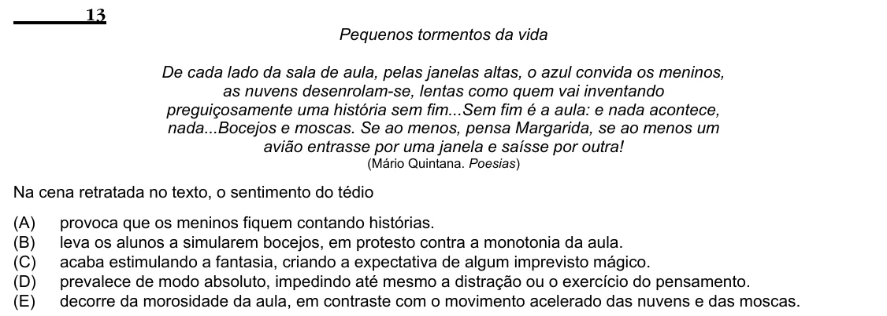

Texto extraído (pode conter ruído)

13  
Pequenos tormentos da vida  
De cada lado da sala de aula, pelas janelas altas, o azul convida os meninos,  
as nuvens desenrolam-se, lentas como quem vai inventando  
preguiçosamente uma história sem fim...Sem fim é a aula: e nada acontece,  
nada...Bocejos e moscas. Se ao menos, pensa Margarida, se ao menos um  
avião entrasse por uma janela e saísse por outra!  
(Mário Quintana. Poesias)  
Na cena retratada no texto, o sentimento do tédio  
(A)  
provoca que os meninos fiquem contando histórias.  
(B)  
leva os alunos a simularem bocejos, em protesto contra a monotonia da aula.  
(C)  
acaba estimulando a fantasia, criando a expectativa de algum imprevisto mágico.  
(D)  
prevalece de modo absoluto, impedindo até mesmo a distração ou o exercício do pensamento.  
(E)  
decorre da morosidade da aula, em contraste com o movimento acelerado das nuvens e das moscas.

