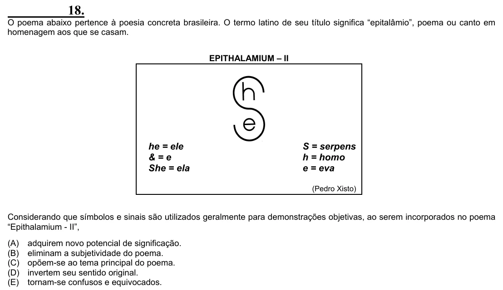

Texto extraído (pode conter ruído)

18.  
O poema abaixo pertence à poesia concreta brasileira. O termo latino de seu título significa “epitalâmio”, poema ou canto em  
homenagem aos que se casam.  
EPITHALAMIUM – II  
he = ele  
S = serpens  
& = e  
h = homo  
She = ela  
e = eva  
(Pedro Xisto)  
Considerando que símbolos e sinais são utilizados geralmente para demonstrações objetivas, ao serem incorporados no poema  
“Epithalamium - II”,  
(A)  
adquirem novo potencial de significação.  
(B)  
eliminam a subjetividade do poema.  
(C)  
opõem-se ao tema principal do poema.  
(D)  
invertem seu sentido original.  
(E)  
tornam-se confusos e equivocados.

