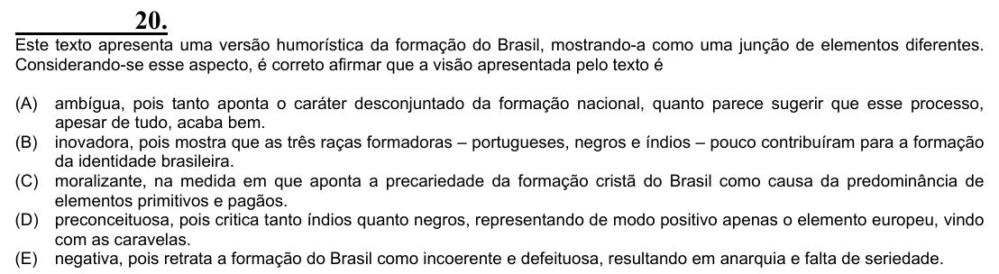

Texto extraído (pode conter ruído)

20.  
Este texto apresenta uma versão humorística da formação do Brasil, mostrando-a como uma junção de elementos diferentes.  
Considerando-se esse aspecto, é correto afirmar que a visão apresentada pelo texto é  
(A)  
ambígua, pois tanto aponta o caráter desconjuntado da formação nacional, quanto parece sugerir que esse processo,  
apesar de tudo, acaba bem.  
(B) inovadora, pois mostra que as três raças formadoras – portugueses, negros e índios – pouco contribuíram para a formação  
da identidade brasileira.  
(C) moralizante, na medida em que aponta a precariedade da formação cristã do Brasil como causa da predominância de  
elementos primitivos e pagãos.  
(D) preconceituosa, pois critica tanto índios quanto negros, representando de modo positivo apenas o elemento europeu, vindo  
com as caravelas.  
(E) negativa, pois retrata a formação do Brasil como incoerente e defeituosa, resultando em anarquia e falta de seriedade.

