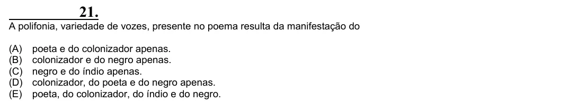

Texto extraído (pode conter ruído)

21.  
A polifonia, variedade de vozes, presente no poema resulta da manifestação do  
(A)  
poeta e do colonizador apenas.  
(B)  
colonizador e do negro apenas.  
(C)  
negro e do índio apenas.  
(D)  
colonizador, do poeta e do negro apenas.  
(E)  
poeta, do colonizador, do índio e do negro.

