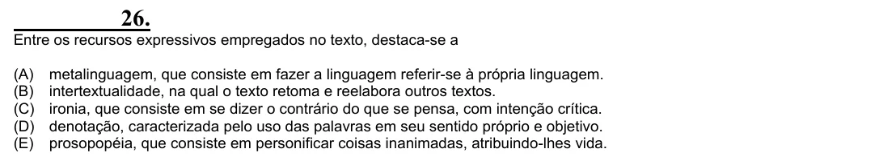

Texto extraído (pode conter ruído)

26.  
Entre os recursos expressivos empregados no texto, destaca-se a  
(A)  
metalinguagem, que consiste em fazer a linguagem referir-se à própria linguagem.  
(B)  
intertextualidade, na qual o texto retoma e reelabora outros textos.  
(C)  
ironia, que consiste em se dizer o contrário do que se pensa, com intenção crítica.  
(D)  
denotação, caracterizada pelo uso das palavras em seu sentido próprio e objetivo.  
(E)  
prosopopéia, que consiste em personificar coisas inanimadas, atribuindo-lhes vida.

