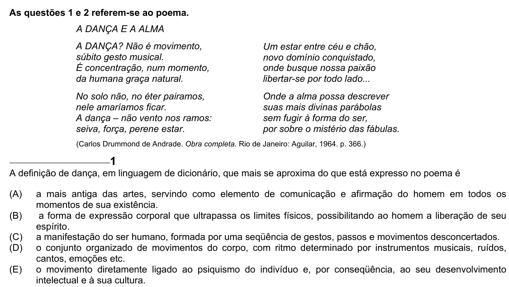

Texto extraído (pode conter ruído)

As questões 1 e 2 referem-se ao poema.  
A DANÇA E A ALMA  
A DANÇA? Não é movimento,  
Um estar entre céu e chão,  
súbito gesto musical.  
novo domínio conquistado,  
É concentração, num momento,  
onde busque nossa paixão  
da humana graça natural.  
libertar-se por todo lado...  
No solo não, no éter pairamos,  
Onde a alma possa descrever  
nele amaríamos ficar.  
suas mais divinas parábolas  
A dança – não vento nos ramos:  
sem fugir à forma do ser,  
seiva, força, perene estar.  
por sobre o mistério das fábulas.  
(Carlos Drummond de Andrade. Obra completa. Rio de Janeiro: Aguilar, 1964. p. 366.)  
1  
A definição de dança, em linguagem de dicionário, que mais se aproxima do que está expresso no poema é  
(A)  
a mais antiga das artes, servindo como elemento de comunicação e afirmação do homem em todos os  
momentos de sua existência.  
(B)  
a forma de expressão corporal que ultrapassa os limites físicos, possibilitando ao homem a liberação de seu  
espírito.  
(C)  
a manifestação do ser humano, formada por uma seqüência de gestos, passos e movimentos desconcertados.  
(D)  
o conjunto organizado de movimentos do corpo, com ritmo determinado por instrumentos musicais, ruídos,  
cantos, emoções etc.  
(E)  
o movimento diretamente ligado ao psiquismo do indivíduo e, por conseqüência, ao seu desenvolvimento  
intelectual e à sua cultura.

